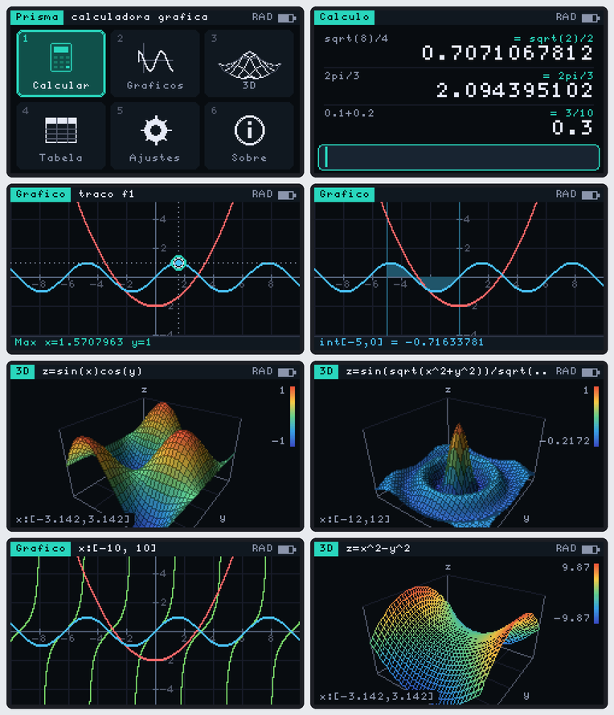

# Prisma — calculadora gráfica científica para o Cardputer ADV

Firmware para o **M5Stack Cardputer ADV** (ESP32‑S3, 240×135, sem PSRAM): calculadora científica, gráficos 2D com análise, superfícies 3D sombreadas e tabela de valores.

## Gravar (sem instalar nada)

Baixe o binário em **[Releases → latest](../../releases/latest)** (ou na branch `binarios`):

1. No Chrome, abra o [ESP Web Flasher](https://espressif.github.io/esptool-js/) e ligue o Cardputer ADV pelo USB‑C.
2. **Connect** (se não aparecer: desligue, segure **G0** e ligue o cabo).
3. Grave **`prisma-full.bin`** no endereço **`0x0`**. Desligue e ligue.

| Arquivo | Para que serve |
|---|---|
| `prisma-full.bin` | tudo junto (bootloader, partições e Prisma); gravar em `0x0` |
| `prisma.bin` | só o app: para o M5Launcher (copie para o SD) ou o M5Burner |

Os binários são gerados pelo GitHub Actions a cada push na `main`.



## O que tem

| Modo | Recursos |
|---|---|
| **Cálculo** | histórico estilo console; multiplicação implícita (`2x`, `3(x+1)`, `2pi`); `ans`; variáveis `a=5` (a..z, guardadas na NVS); resultado exato ao lado do decimal (`3/4`, `2pi/3`, `sqrt(2)/2`); graus/radianos; casas fixas |
| **Funções** | 4 funções `f1..f4(x)` com cor própria; liga/desliga; erro de sintaxe marcado na hora |
| **Gráfico 2D** | zoom, pan, traço; assíntotas detectadas (tan, 1/x sem riscos verticais); **raiz, mínimo, máximo, interseção, dy/dx com reta tangente, integral com área sombreada**; ajuste automático do eixo y |
| **3D** | `z = f(x,y)` com malha até 40×40, sombreamento por normal + mapa de cores por altura, algoritmo do pintor, perspectiva, rotação livre, giro automático, vistas prontas (iso/topo/frente/lado), esticar z, estilos sólido/sólido+malha/malha, recorte automático de picos (1/(x²+y²)) e preenchimento de singularidades removíveis (sinc) |
| **Tabela** | x, f1..f3 com início e passo configuráveis |
| **Ajustes** | ângulo, casas decimais, cor de destaque (6), grade 3D, brilho |

### Funções disponíveis

`sin cos tan sec csc cot asin acos atan atan2 sinh cosh tanh asinh acosh atanh exp ln log log(x,b) log2 sqrt cbrt root(x,n) abs floor ceil round(x[,n]) sign ipart fpart min max mod gcd lcm ncr npr hypot gamma rand`, fatorial `!`, `|x|`, constantes `pi e phi ans`.

Especiais (variável ligada é sempre `x`):

| | |
|---|---|
| `int(x^2,0,3)` | integral (Gauss–Kronrod 15 adaptativo com troca de variável; aguenta `1/sqrt(x)` em 0) |
| `der(sin(x),0)` | derivada (diferença central + Richardson) |
| `sum(1/x^2,1,99)` / `prod(x,1,5)` | somatório / produtório |
| `solve(x^3-x-1)` | raiz perto do chute (Newton amortecido + busca de troca de sinal) |
| `f1(2)` | usa uma função do gráfico |

## Teclas

Segue o padrão do [Órbita](https://github.com/TiroLiroLa/OrbitaOS): `;` `.` `,` `/` são setas; em campos de texto use **fn** + seta. `` ` `` volta. **Tab** abre o menu de opções do modo.

| Onde | Tecla | Ação |
|---|---|---|
| Início | setas / `1`–`6` / Enter | escolher modo; `6` = Sobre |
| Cálculo | Enter | calcula |
| | fn `;` `.` | percorre o histórico (Enter reutiliza a expressão, Tab insere o resultado) |
| | fn `,` `/` · ctrl `,` `/` | cursor · início/fim |
| | Del · fn+Del · ctrl+Del | apaga · apaga à frente · limpa a linha |
| | `+ * / ^` numa linha vazia | começa com `ans` |
| Funções | fn `;` `.` · Enter · fn+Enter | troca de linha · plota · liga/desliga |
| Gráfico | setas · `=` `-` | move · zoom |
| | Enter ou `t` · `1`–`4` | modo traço · traço na função n |
| | `a` · `r` · Tab | ajusta y · janela padrão · análise |
| 3D | `,` `/` · `;` `.` (fn = passo fino) | gira · inclina |
| | `=` `-` · `[` `]` · espaço | zoom · estica z · gira sozinho |
| | `1`–`4` · `r` · Enter | vistas · padrão · editar função |

## Compilar

```sh
pio run                 # compila (mesma plataforma e bibliotecas do Órbita)
pio run -t upload       # grava direto pelo USB
bash tools/merge.sh     # gera out/prisma-full.bin e out/prisma.bin (precisa do esptool)
```

Mapa da flash (`partitions.csv`): `nvs` 24 KB (ajustes, funções e variáveis, namespace `prisma`) e `factory` 3 MB com o Prisma.

O núcleo (`src/core/`) não depende do hardware, então também dá para embutir o Prisma no Órbita como app nativo: basta uma classe que converta o `M5Canvas` em `px::Gfx` e o `KeyEvent` em `px::Key`.

## Simulador e testes (no PC)

O núcleo inteiro (`src/core/`) é C++11 portável e não conhece o hardware: desenha por uma interface `Gfx` e recebe `Key`. O simulador usa o mesmo código e grava as telas:

```sh
sh sim/shots.sh          # gera sim/out/*.png
g++ -std=c++11 -Isrc tests/test_expr.cpp src/core/expr.cpp src/core/numeric.cpp -o t && ./t
```

Roteiro do simulador: `build/prisma_sim "2{fn+.}{fn+.}tan(x){enter}{tab}3{shot:tela}" pasta`.

## Arquitetura

```
src/
├── main.cpp          firmware sozinho: M5Canvas → Gfx, teclado com repetição, NVS
└── core/
    ├── expr          lexer + parser → bytecode (pilha) + VM; sem alocação
    ├── numeric       integral, derivada, raízes, extremos, formatação, forma exata
    ├── gfx.h         interfaces Gfx / Key / Platform
    ├── ui            tema, campo de texto, menu, formulário, caixa de texto
    ├── app           estado, persistência, Início, Ajustes
    ├── calc          modo Cálculo
    ├── graph2d       Funções, Gráfico 2D, Tabela
    └── graph3d       superfície 3D
sim/                  simulador de desktop + roteiros de captura
tests/                testes do motor (119 casos)
```

Expressões são compiladas uma vez para bytecode e avaliadas milhares de vezes por quadro. Os buffers do 3D (~45 KB) só existem enquanto o 3D está aberto, e a tela é um sprite 240×135 enviado inteiro (sem piscar).

## Ainda não validado no hardware

O motor tem 119 testes e a interface inteira roda no simulador (também com AddressSanitizer). Falta confirmar no aparelho a velocidade do 3D em 40×40 (o S3 só tem FPU de precisão simples; o cálculo usa `double` e a projeção usa `float`). Se ficar lento, use a grade 32×32 ou 24×24 em **Ajustes**.
